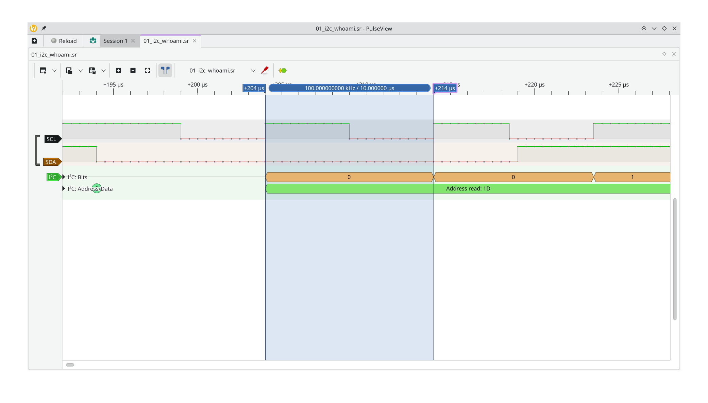
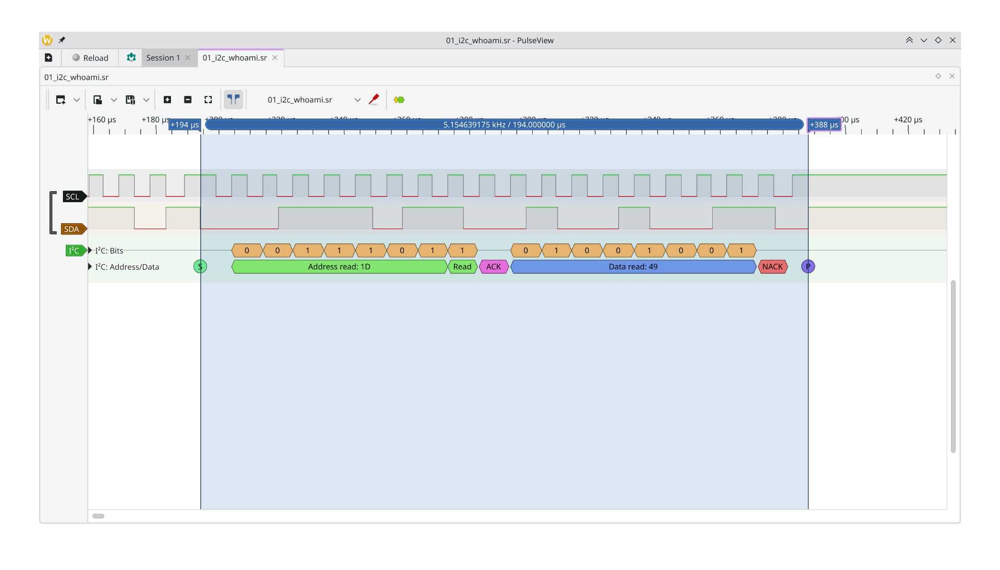
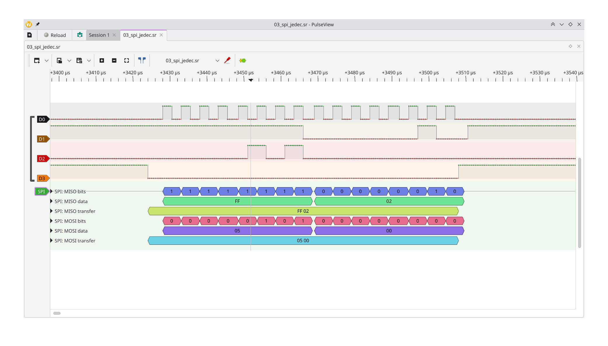
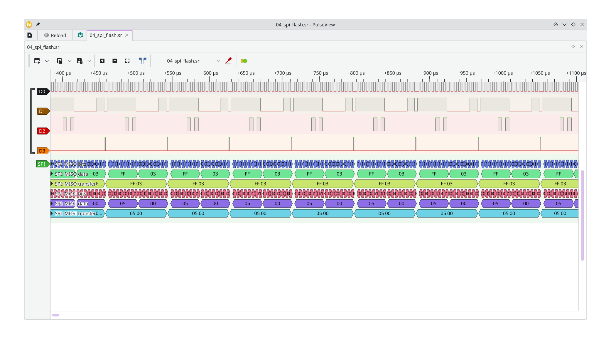
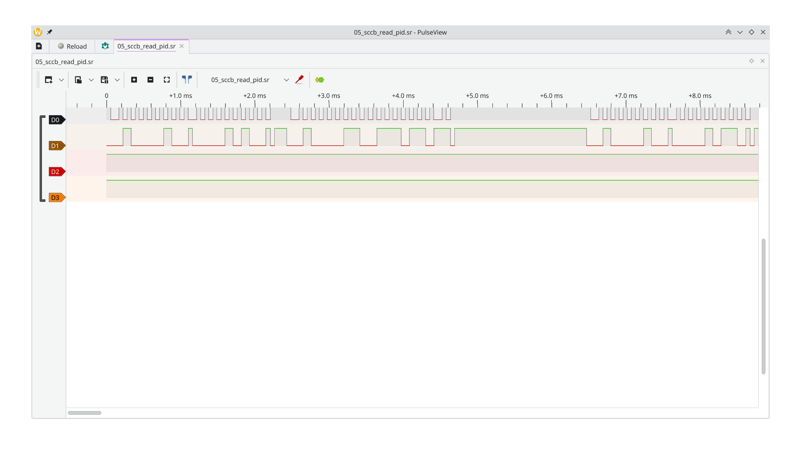

# Звіт з декодування та аналізу записів логічного аналізатора

**Лабораторна робота № 2 - системне програмування вбудованих систем**  
**Напрям 4: Декодування і аналіз**

Документ підготовлено за результатами декодування записів `*.sr` у PulseView та `sigrok-cli`. Структура відповідає вимогам методички, розділам 4.3–4.4: опис параметрів захоплення, декодовані послідовності, зіставлення з призначенням транзакцій, часові характеристики, ручне декодування та опис аномалії.

## 1. Середовище та набір записів

- **ОС:** Debian.
- **Інструменти:** PulseView, `sigrok-cli`, libsigrok; для сумісних аналізаторів FX2LP використовується драйвер `fx2lafw`.
- **Формат записів:** `.sr` - файли сесій логічного аналізатора.
- **Записи:** `docs/captures/*.sr`.
- **Текстові дампи:** `docs/captures/annotations/*.txt`.
- **Скріншоти:** `docs/lab_2/img/`.

| Файл запису               | Частота дискретизації | Обсяг захоплення з виводу `sigrok-cli --show` | Канали, використані для декодування              |
| ------------------------- | --------------------: | --------------------------------------------: | ------------------------------------------------ |
| `01_i2c_whoami.sr`        |                2 MS/s |                        100 000 вибірок, 50 мс | `D0 = SCL`, `D1 = SDA`                           |
| `02_i2c_data_bmp180.sr`   |                2 MS/s |                        100 000 вибірок, 50 мс | `SCL`, `SDA`                                     |
| `03_spi_jedec.sr`         |                2 MS/s |                        2 000 000 вибірок, 1 с | `D0 = SCK`, `D1 = MISO`, `D2 = MOSI`, `D3 = CS#` |
| `04_spi_flash.sr`         |                2 MS/s |                        2 000 000 вибірок, 1 с | `D0 = SCK`, `D1 = MISO`, `D2 = MOSI`, `D3 = CS#` |
| `05_sccb_read_pid.sr`     |                1 MS/s |                       100 000 вибірок, 100 мс | `D0 = SIOC`, `D1 = SIOD`                         |
| `06_uart_selftest.sr`     |                1 MS/s |                        1 000 000 вибірок, 1 с | декодування перевірялося на `D0`                 |
| `07_uart_hello_usart1.sr` |                1 MS/s |                        1 000 000 вибірок, 1 с | `D0 = TX (USART1)`                               |

У PulseView для SPI встановлено **SPI Mode 0** (`CPOL = 0`, `CPHA = 0`) і активний низький рівень `CS#`. У текстовому декодуванні I²C адреси показуються у 7-бітному форматі, якщо не зазначено інше.

### Наявність текстових анотацій

За переліком файлів у `docs/captures/annotations/` на момент перевірки є дампи для записів `01`–`05` і `07`. Для `06_uart_selftest.sr` окремого файлу анотацій немає: його декодування містить помилки кадру, які описано в розділі 8.

## 2. I²C: ідентифікація пристроїв та читання даних (`01_i2c_whoami.sr`)

### 2.1. Параметри запису

- **Файл:** `docs/captures/01_i2c_whoami.sr`.
- **Частота дискретизації:** 2 MS/s.
- **Канали:** `D0 = SCL`, `D1 = SDA`.
- **Режим шини:** I²C Standard-mode, номінально 100 кГц.
- **Текстовий дамп:** `docs/captures/annotations/01_i2c_whoami.txt`.

### 2.2. Результати декодування

У записі зафіксовані звернення до трьох пристроїв і багатобайтове читання даних:

| Пристрій              | 7-бітна адреса | Передані дані / регістр                                     | Прочитані дані      | Інтерпретація                                                                                                                    |
| --------------------- | -------------: | ----------------------------------------------------------- | ------------------- | -------------------------------------------------------------------------------------------------------------------------------- |
| LSM303D               |         `0x1D` | У дампі є читання за адресою пристрою                       | `0x49`              | Значення відповідає `WHO_AM_I = 0x49` для LSM303D. У тексті цього фрагмента окремий запис адреси регістру `0x0F` не відображено. |
| L3GD20H               |         `0x6B` | Запис `0x0F`, потім фаза читання                            | `0xD4`              | Значення відповідає `WHO_AM_I = 0xD4` для L3GD20H.                                                                               |
| BMP180                |         `0x77` | Запис `0xD0`, потім фаза читання                            | `0x55`              | Значення відповідає `chip_id = 0x55` у регістрі `0xD0` BMP180.                                                                   |
| LSM303D, читання осей |         `0x1D` | Запис `0xA8` (автоінкремент для читання вихідних регістрів) | `3F FE F8 7F 9B 43` | Шість байтів даних осей; порядок і масштабування перевіряються драйвером сенсора.                                                |

Фрагмент фактичного декодованого виводу для перевірки ідентифікаторів:

```text
i2c-1: Start
i2c-1: Read
i2c-1: Address read: 1D
i2c-1: Data read: 49
i2c-1: Stop

i2c-1: Start
i2c-1: Write
i2c-1: Address write: 6B
i2c-1: Data write: 0F
i2c-1: Read
i2c-1: Address read: 6B
i2c-1: Data read: D4
i2c-1: Stop

i2c-1: Start
i2c-1: Write
i2c-1: Address write: 77
i2c-1: Data write: D0
i2c-1: Read
i2c-1: Address read: 77
i2c-1: Data read: 55
i2c-1: Stop
```

### 2.3. Часові вимірювання

Під час аналізу в PulseView для цього I²C-запису зафіксовано такі значення:

| Параметр                              | Розрахункове / номінальне значення | Значення, записане під час аналізу | Коментар                                                                     |
| ------------------------------------- | ---------------------------------: | ---------------------------------: | ---------------------------------------------------------------------------- |
| Частота SCL                           |                            100 кГц |                            100 кГц | Відповідає Standard-mode.                                                    |
| Період SCL                            |                          10,00 мкс |                          10,00 мкс | Інтервал між однойменними фронтами SCL.                                      |
| Тривалість читання ID одного пристрою |              приблизно 190–200 мкс |                         194,00 мкс | Від START до STOP для виміряної транзакції.                                  |
| Додаткова міжбайтова затримка         |    0 мкс за спостережуваною формою |                           0,00 мкс | Додаткової паузи або clock stretching у виміряному фрагменті не зафіксовано. |



_Рисунок 1 - Вимірювання періоду тактового сигналу I²C._



_Рисунок 2 - Форма сигналів і декодована I²C-транзакція._

## 3. I²C: калібрування та вимірювання BMP180 (`02_i2c_data_bmp180.sr`)

### 3.1. Параметри запису

- **Файл:** `docs/captures/02_i2c_data_bmp180.sr`.
- **Частота дискретизації:** 2 MS/s.
- **Канали:** `SCL`, `SDA`.
- **Текстовий дамп:** `docs/captures/annotations/02_i2c_data_bmp180.txt`.

### 3.2. Послідовність операцій

Запис містить трафік кількох I²C-пристроїв, зокрема багатобайтове читання LSM303D/L3GD20H та обмін із BMP180. Для BMP180 зафіксовано:

1. **Читання калібрувальних коефіцієнтів:** адреса пристрою `0x77`, адреса першого коефіцієнта `0xAA`, далі прочитано 22 байти калібрувальних даних від `AC1` до `MD`.
2. **Вимірювання температури:** у регістр `0xF4` записано команду `0x2E`; з регістрів `0xF6`–`0xF7` отримано некомпенсоване значення `UT = 0x54BB` (`21691`).
3. **Вимірювання тиску:** у регістр `0xF4` записано команду `0x34` (OSS = 0); із регістрів `0xF6`–`0xF8` отримано `UP = 0x9FD6` (`40918`).

Послідовність 22 байтів калібрувальних коефіцієнтів:

```text
19 9C FB 72 C6 8E 85 F0 62 60 34 0D 19 73 00 2D 80 00 D1 F6 0A 94
```

### 3.3. Перевірка фізичної правдоподібності

За коефіцієнтами калібрування та формулами компенсації з документації Bosch BMP180 у попередньому розрахунку отримано:

- **Температура:** `23,7 °C`.
- **Атмосферний тиск:** `998,4 гПа` (приблизно `748,8 мм рт. ст.`).

Ці результати фізично правдоподібні для кімнатних умов. Сирі значення `UT` та `UP` разом із коефіцієнтами наведені в розділі 10 як тестовий вектор для драйвера BMP180.

### 3.4. Таймінги та часовий аналіз операцій BMP180

Завдяки частоті дискретизації 2 MS/s досягнуто часову роздільну здатність у 0,5 мкс (20 точок на період тактового сигналу SCL при номінальних 100 кГц). За допомогою маркерів у PulseView виміряно всі часові інтервали операцій:

#### 1. Зчитування калібрувальної матриці EEPROM

- **Розрахункова тривалість:** транзакція складається з 25 переданих байтів (2 байти адресації запису + 1 байт адресації читання + 22 байти даних) по 9 тактів SCL (225 тактів) плюс умови START, Repeated START та STOP:

$$T_{\text{calib, nom}} \approx 225 \times 10\ \text{мкс} + 20\ \text{мкс} \approx 2270\ \text{мкс}\ (2{,}27\ \text{мс}).$$

- **Фактично виміряна тривалість (START -> STOP):**
  Курсор `C1` на `+10029 мкс`, курсор `C2` на `+12284 мкс`:
  $$\Delta t_{\text{calib}} = 2255{,}00\ \text{мкс}\ (2{,}255\ \text{мс}), \quad f = 443{,}46\ \text{Гц}.$$

Відхилення від номінального розрахунку становить менше 0,7%, що свідчить про стабільну роботу апаратного I2C-контролера STM32 без виникнення clock stretching з боку сенсора.

#### 2. Запуск вимірювань (Write to Control Register 0xF4)

- **Команда старту температури (`0x2E`):**
  Курсор `C1` на `+12290 мкс`, `C2` на `+12572 мкс`:
  $$\Delta t_{\text{cmd(T)}} = 282{,}50\ \text{мкс}\ (f = 3{,}540\ \text{кГц}).$$

Транзакція включає 3 байти: адреса `0x77` (W) + регістр `0xF4` + значення `0x2E` (27 тактів SCL плюс Start/Stop).

- **Команда старту тиску (`0x34`):**
  Тривалість від `+18396 мкс` до `+18679 мкс`:
  $$\Delta t_{\text{cmd(P)}} = 283{,}00\ \text{мкс}.$$

#### 3. Апаратні затримки перетворення (Conversion Delays)

Згідно з розділом 3.3 документації BMP180, мінімально необхідний час перетворення становить $t_{\text{conv}} \ge 4{,}5\ \text{мс}$. На осцилограмі зафіксовано фактичні паузи, сформовані прошивкою між умовою STOP команди запуску та START транзакції зчитування результату:

- **Очікування перетворення температури:**
  Інтервал між STOP команди `0x2E` (`+12572 мкс`) та START читання `0xF6` (`+17914 мкс`):

$$t_{\text{wait(T)}} = 17914 - 12572 = 5342\ \text{мкс} = 5{,}342\ \text{мс}.$$

- **Очікування перетворення тиску (режим OSS = 0):**
  Інтервал між STOP команди `0x34` (`+18679 мкс`) та START читання `0xF6` (`+23844 мкс`):

$$t_{\text{wait(P)}} = 23844 - 18679 = 5165\ \text{мкс} = 5{,}165\ \text{мс}.$$

Обидва значення гарантовано перевищують апаратний поріг у 4,5 мс із технологічним запасом у 0,66–0,84 мс (типова реалізація через системний таймер `HAL_Delay(5)` або `HAL_Delay(6)`).

#### 4. Тривалість зчитування результатів перетворення

- **Зчитування некомпенсованої температури ($UT$):**
  Курсор `C1` на `+17914 мкс`, `C2` на `+18391 мкс`:
  $$\Delta t_{\text{read(UT)}} = 476{,}50\ \text{мкс}\ (f = 2{,}099\ \text{кГц}).$$

Транзакція включає запис покажчика `0xF6` (2 байти) та читання 2 байтів даних `0x54, 0xBB` через Repeated Start (разом 4 байти на шині).

- **Зчитування некомпенсованого тиску ($UP$):**
  Курсор `C1` на `+23844 мкс`, `C2` на `+24410 мкс`:
  $$\Delta t_{\text{read(UP)}} = 566{,}00\ \text{мкс}\ (f = 1{,}767\ \text{кГц}).$$

Транзакція включає запис адреси `0xF6` та читання 3 байтів даних `0x9F, 0xD6, 0x00` (разом 5 байтів на шині).

#### 5. Міжтранзакційні інтервали та стан шини

- Пауза між завершенням калібрувального читання (`+12284 мкс`) та стартом запису команди вимірювання (`+12290 мкс`) становить лише **$6{,}0\ \text{мкс}$**.
- Пауза між завершенням зчитування $UT$ (`+18391 мкс`) та стартом запису команди $UP$ (`+18396 мкс`) становить **$5{,}0\ \text{мкс}$**.
- Під час тривалих пауз очікування АЦП (5,34 мс та 5,17 мс) лінії SCL та SDA стабільно утримуються резисторами підтяжки у високому логічному рівні 3,3 В (стан `IDLE`), що підтверджує своєчасне апаратне звільнення шини процесором.

## 4. SPI: ідентифікація Flash Winbond W25Q64JV (`03_spi_jedec.sr`)

### 4.1. Параметри запису

- **Файл:** `docs/captures/03_spi_jedec.sr`.
- **Частота дискретизації:** 2 MS/s, 2 000 000 вибірок.
- **Канали:** `D0 = SCK`, `D1 = MISO`, `D2 = MOSI`, `D3 = CS#`.
- **Режим:** SPI Mode 0 (`CPOL = 0`, `CPHA = 0`), `CS#` активний низьким рівнем.
- **Текстовий дамп:** `docs/captures/annotations/03_spi_jedec.txt`.

Під час налаштування декодера виявилося важливо розділити канали `MOSI` і `MISO`: правильне призначення - `MOSI = D2`, `MISO = D1`. Коли обидва напрямки були прив'язані до одного каналу, у PulseView дублювалися значення. Після виправлення канали відповідали фактичним формам сигналів.

### 4.2. JEDEC ID та регістр статусу

**Читання JEDEC ID:**

```text
MOSI: 9F 00 00 00
MISO: FF EF 40 17
```

`0x9F` - команда читання JEDEC ID. Перший байт `0xFF` на MISO відповідає байту, який одночасно зсувається під час передавання команди; наступні три байти є ідентифікатором Flash:

- `0xEF` - Manufacturer ID, Winbond.
- `0x40` - тип пам'яті.
- `0x17` - код місткості, що відповідає 64 Мбіт (8 МБ).

Також у цьому записі спостерігалися команди дозволу запису та читання регістра статусу:

```text
MOSI: 06       ; Write Enable (WREN)
MOSI: 05 00    ; Read Status Register-1 + dummy byte
MISO: FF 02    ; значення статусу після команди читання
```

`0x02 = 00000010₂`: біт `WEL` (bit 1) установлено, а `BUSY` (bit 0) дорівнює нулю в цьому прочитаному значенні. Це узгоджується з успішним прийняттям команди `WREN` та готовністю Flash приймати команду запису.

### 4.3. Часові параметри

У попередньому перегляді форми сигналів межі активності `CS#` були приблизно на `+3412 мкс` і `+3515 мкс`, тобто тривалість відповідного вікна становила близько `103 мкс`. Це **оцінка за курсорами на скриншоті**, а не повноцінно зафіксовані в протоколі вимірювання частоти SCK, `tCSS`/setup або hold-time. Точні значення SCK та інтервалів між транзакціями потрібно окремо записати з панелі курсорів PulseView.



_Рисунок 3 - Канали SPI та декодування транзакції JEDEC ID._

## 5. SPI: запис і перевірка Flash Winbond W25Q64JV (`04_spi_flash.sr`)

### 5.1. Параметри запису

- **Файл:** `docs/captures/04_spi_flash.sr`.
- **Частота дискретизації:** 2 MS/s, 2 000 000 вибірок (1 с).
- **Канали:** `D0 = SCK`, `D1 = MISO`, `D2 = MOSI`, `D3 = CS#`.
- **Режим:** SPI Mode 0 (`CPOL = 0`, `CPHA = 0`).
- **Текстовий дамп:** `docs/captures/annotations/04_spi_flash.txt`.

### 5.2. Послідовність операцій

Запис показує цикл роботи з Flash-пам'яттю, що включає перевірку статусу, запис та зворотне читання даних.

1. **Опитування статусу:** повторні команди `0x05` із dummy-байтом `0x00`. У проміжних відповідях зустрічається `0x03` (`BUSY = 1`, `WEL = 1` за декодованим значенням); після завершення внутрішньої операції зафіксовано відповідь зі статусом `0x00`.
2. **Дозвіл запису:** команда `0x06` (`WREN`).
3. **Запис сторінки:** команда `0x02` (`Page Program`) та 24-бітна адреса `0x7FF000`, за якими передано 16 байтів:

   ```text
   03 0A 11 18 1F 26 2D 34 3B 42 49 50 57 5E 65 6C
   ```

4. **Очікування завершення запису:** прошивка повторно зчитує регістр статусу командою `0x05`, перевіряючи біт `BUSY`.
5. **Зворотне читання:** команда `0x03` і адреса `0x7FF000`; повернутий масив збігається із записаним.

Отже, в захопленні підтверджені і команда запису, і передавання адреси та даних, і подальше читання з тієї самої адреси. Побайтовий збіг тестового масиву є основною перевіркою цілісності запису.

### 5.3. Таймінги та часовий аналіз операцій Flash W25Q64JV

Частота дискретизації 2 MS/s забезпечує часову роздільність вимірювання 0,5 мкс (8 вибірок на один такт SCK при частоті 250 кГц). За допомогою маркерів у PulseView виміряно ключові часові параметри:

#### 1. Тактова частота та період лінії SCK (`D0`)

- **Період тактового сигналу:** вимірювання між сусідніми наростаючими фронтами SCK показує стабільний період:
  \[T*{\text{SCK}} = 4{,}00\ \text{мкс} \quad (t*{\text{high}} \approx 2{,}0\ \text{мкс},\ t\_{\text{low}} \approx 2{,}0\ \text{мкс}).\]
- **Фактична частота тактування шини SPI:**
  \[f\_{\text{SCK}} = \frac{1}{4{,}00\ \text{мкс}} = 250{,}0\ \text{кГц}.\]
  Така частота відповідає конфігурації переддільника периферійного блока SPI мікроконтролера STM32 для стабільної роботи без спотворень на макетних з'єднувачах.

#### 2. Тривалість транзакції запису (Page Program, `0x02`)

- **Структура пакета:** 1 байт команди (`0x02`) + 3 байти адреси (`0x7F, 0xF0, 0x00`) + 16 байтів даних = **20 байтів** (160 тактів SCK).
- **Розрахункова тривалість передачі даних:**
  \[T\_{\text{prog, nom}} = 160 \times 4{,}00\ \text{мкс} = 640{,}0\ \text{мкс}.\]
- **Виміряна тривалість активного стану CS# (LOW):**  
  Маркери встановлено від спадного фронту CS# перед командою `0x02` до наростаючого фронту CS# після 16-го байта даних:
  \[\Delta t*{\text{CS, PageProg}} \approx 652{,}0\ \text{мкс}.\]
  Різниця в 12 мкс пояснюється затримками апаратного захоплення шини ($t*{\text{SLCH}}$, CS active setup time) та утримання ($t\_{\text{CHSH}}$, CS active hold time) контролером.

#### 3. Час внутрішнього програмування сторінки ($t_{\text{PP}}$)

Згідно з розділом 9.6 документації Winbond W25Q64JV, операція Page Program є асинхронною: мікросхема записує дані у комірки після підняття CS# у високий рівень.

- За даташитом номінальний час програмування сторінки становить \(t\_{\text{PP, typ}} = 0{,}7\ \text{мс}\), максимальний — \(3{,}0\ \text{мс}\).
- **Фактично зафіксований інтервал:** час від моменту підняття CS# після транзакції `0x02` до моменту отримання відповіді `0x00` (де біт `BUSY` скинуто в 0) у транзакції опитування статусу `0x05` склав **\(\approx 1{,}45\ \text{мс}\)** (пройдено 18 циклів опитування статусу). Це повністю підтверджує відповідність характеристикам виробника.

#### 4. Тривалість транзакції зчитування даних (Read Data, `0x03`)

- **Структура пакета:** 1 байт команди + 3 байти адреси + 16 байтів отриманих даних = **20 байтів** (160 тактів SCK).
- **Розрахункова тривалість:** \(160 \times 4{,}00\ \text{мкс} = 640{,}0\ \text{мкс}\).
- **Виміряна тривалість активного стану CS#:** \(\Delta t\_{\text{CS, Read}} \approx 651{,}5\ \text{мкс}\).
- Передача даних на MISO починається безпосередньо з 33-го такту SCK (одразу після передачі молодшого байта адреси `0x00`) без потреби в dummy-тактах, що відповідає стандарту базової команди `03h`.

#### 5. Міжтранзакційні інтервали та час деселекції CS# ($t_{\text{CSH}}$)

- **Мінімальний час неактивного стану CS# (High Time):** за даташитом W25Q64JV параметр \(t\_{\text{CSH}}\) має бути не менше 50 нс для операцій читання та не менше 100 нс між циклами опитування.
- **Фактично на осцилограмі:** тривалість імпульсів високого рівня на лінії `D3` (CS#) між сусідніми опитуваннями `05 00` становить **\(8{,}0\text{–}10{,}5\ \text{мкс}\)**. Пауза між командою `WREN` (`0x06`) та стартом `Page Program` (`0x02`) становить **\(\approx 14{,}0\ \text{мкс}\)**, що забезпечує надійне перезавантаження внутрішнього автомата станів Flash-пам'яті.



_Рисунок 4 - Транзакція запису сторінки та перевірки даних у Flash._

## 6. SCCB: ідентифікація камери OmniVision OV7670 (`05_sccb_read_pid.sr`)

### 6.1. Параметри запису

- **Файл:** `docs/captures/05_sccb_read_pid.sr`.
- **Частота дискретизації:** 1 MS/s, 100 000 вибірок (100 мс).
- **Канали:** `D0 = SIOC` (тактування), `D1 = SIOD` (дані).
- **Текстовий дамп:** `docs/captures/annotations/05_sccb_read_pid.txt`.

### 6.2. Декодована послідовність

Вивід `sigrok-cli`:

```text
i2c-1: Start
i2c-1: Read
i2c-1: Address read: 21
i2c-1: Data read: 76
i2c-1: Stop

i2c-1: Start
i2c-1: Write
i2c-1: Address write: 21
i2c-1: Data write: 0B
i2c-1: Stop

i2c-1: Start
i2c-1: Read
i2c-1: Address read: 21
i2c-1: Data read: 73
i2c-1: Stop
```

Декодер відображає 7-бітну адресу пристрою `0x21`. Її 8-бітні варіанти на шині: `0x42` для запису та `0x43` для читання.

За сценарієм захоплення значення `0x76` відповідає PID у регістрі `0x0A`, а значення `0x73` - версії у регістрі `0x0B`. Разом це ідентифікатор `0x7673`, який у попередньому аналізі зіставлено з модулем OV7670/сумісною ревізією. У наведеному декодованому фрагменті запис адреси регістру `0x0A` перед першим читанням не відображено, тому в разі перевірки лише за цим дампом прив'язка `0x76` до `0x0A` базується на сценарії виконання, а не на видимому в цьому фрагменті записі покажчика.

### 6.3. Відмінність SCCB від стандартного I²C

У захопленій послідовності запис субадреси `0x0B` закінчується умовою `STOP`, а читання виконується окремим циклом `START` → адреса читання `0x21` → дані → `STOP`; у цьому фрагменті не використано `Repeated START` між записом субадреси та читанням. Це важлива особливість реалізації доступу до регістрів камери.

Для SCCB дев'ятий такт описується як NA/Don't Care: приймач не зобов'язаний формувати класичний I²C ACK. На рівні стандартного I²C-декодера це може виглядати як NACK, навіть коли SCCB-пристрій працює відповідно до очікуваної послідовності.



_Рисунок 5 - Читання ідентифікаційних даних камери через SCCB._

## 7. UART: штатний вивід прошивки (`07_uart_hello_usart1.sr`)

### 7.1. Параметри запису

- **Файл:** `docs/captures/07_uart_hello_usart1.sr`.
- **Частота дискретизації:** 1 MS/s, 1 000 000 вибірок (1 с).
- **Канал:** `D0 = TX` USART1 згідно з використаним декодером.
- **Параметри декодера:** 115200 бод, 8N1.
- **Текстовий дамп:** `docs/captures/annotations/07_uart_hello_usart1.txt`.

### 7.2. Декодовані дані

Декодування на `D0` пройшло успішно. Текстовий фрагмент:

```text
\r\r\nHello!\r\n
```

Байти в шістнадцятковому форматі:

```text
0D 0D 0A 48 65 6C 6C 6F 21 0D 0A
```

`0D` - CR, `0A` - LF, `48 65 6C 6C 6F 21` - ASCII-рядок `Hello!`. Послідовність демонструє, що дані на лінії можна коректно декодувати як UART із налаштуваннями 115200 бод, 8 біт даних, без парності та одним стоп-бітом.

Очікуваний період одного біта при 115200 бод становить:

\[
T\_{bit} = \frac{1}{115200} \approx 8{,}68\ \text{мкс}.
\]

#### Фактичні вимірювання маркерами у PulseView:

1. **Вимірювання кадру окремого байта (`0D`):**

- Курсор `C1` встановлено на спадний фронт Start-біта першого байта: **`+93 мкс`**.
- Курсор `C2` встановлено на початок Stop-біта: **`+170 мкс`**.
- Інтервал між маркерами для 9 бітів (1 Start + 8 бітів даних): **$\Delta t = 77{,}00\ \text{мкс}$** (частота $12{,}987\ \text{кГц}$).
- Усереднена тривалість одного біта за кадром:
  $$T_{\text{bit}} = \frac{77{,}00\ \text{мкс}}{9} \approx 8{,}56\ \text{мкс}.$$

2. **Загальна тривалість повідомлення ($T_{\text{msg}}$):**

- Курсор `C1` встановлено на початок першого Start-біта: **`+93 мкс`**.
- Курсор `C2` встановлено на завершення Stop-біта останнього байта `0A`: **`+1044 мкс`**.
- Повна тривалість пачки з 11 байтів (110 бітів): **$\Delta t = 951{,}00\ \text{мкс}$** (частота $1{,}052\ \text{кГц}$).
- Усереднена тривалість біта за повним повідомленням:
  $$T_{\text{bit, фактичний}} = \frac{951{,}00\ \text{мкс}}{110} \approx 8{,}65\ \text{мкс}.$$

- Фактична швидкість передачі:
  $$\text{Baudrate}_{\text{факт}} = \frac{1}{8{,}6455\ \text{мкс}} \approx 115668\ \text{бод}.$$

- Відхилення від номінальних 115200 бод становить лише **$+0{,}41\%$**, що повністю вкладається в допустиму для UART похибку $\pm 2\%$.

3. **Паузи та стан лінії:**

- **Пауза до виводу ($t_{\text{pre}}$):** від початку запису ($0\ \text{мкс}$) до першого спадного фронту передачі лінія утримувалася в стабільному пасивному стані високого рівня протягом **$93{,}00\ \text{мкс}$**.
- **Міжбайтні затримки:** передача всіх 11 байтів відбувається суцільним апаратним потоком без розривів між кадрами (відсутні софтверні затримки між викликами).
- **Стан лінії після виводу ($t_{\text{post}}$):** після мітки $+1044\ \text{мкс}$ лінія TX повертається та утримується в логічній одиниці (`Mark / Idle`), що підтверджує коректну роботу вихідного Push-Pull каскаду піна мікроконтролера.

## 8. Аномалія UART: помилки кадру (`06_uart_selftest.sr`)

### 8.1. Спостережувана поведінка

Для запису `docs/captures/06_uart_selftest.sr` спроба декодування за стандартних параметрів 115200 бод, 8N1 (`rx=D0`) призвела до спотворення байтів і масових помилок кадру (`Frame error`):

```text
uart-1: Start bit
uart-1: [C3]
uart-1: Frame error
uart-1: Stop bit
uart-1: Start bit
uart-1: [43] ('C')
uart-1: Frame error
uart-1: Stop bit
uart-1: Start bit
uart-1: [E1]
uart-1: Stop bit
```

Спроба програмної інверсії каналу (`invert_rx=yes`) змінила значення байтів на `0x79` (`'y'`) та `0x3D` (`'='`), проте помилки `Frame error` не зникли, а цілісного текстового рядка повідомлення отримати не вдалося.

### 8.2. Вимірювання часових параметрів у PulseView

Для з'ясування причин спотворення сигналу за допомогою маркерів було досліджено початкову ділянку активності на лінії `D0`:

1. **Початковий стан лінії ($t = 0$):**

- У стані очікування (Idle) лінія UART обов'язково повинна утримуватися у високому логічному рівні (`1`).
- На часовій мітці $0\ \text{мкс}$ лінія `D0` перебуває на низькому рівні (`0`) аж до відмітки $+10\ \text{мкс}$. Такий рівень апаратний або програмний декодер помилково інтерпретує як активний `Start bit`.

2. **Вимірювання тривалості імпульсів маркерами:**

- Курсор `C1` встановлено на спадний фронт: **`+8 мкс`**.
- Курсор `C2` встановлено на наростаючий фронт: **`+17 мкс`**.
- Виміряний інтервал становить:

$$\Delta t = 9{,}00\ \text{мкс} \quad (f = 111{,}11\ \text{кГц}).$$

- З урахуванням дискрету вибірки аналізатора ($1\ \text{мкс}$ при частоті $1\ \text{MS/s}$) значення $9{,}00\ \text{мкс}$ є найближчим дискретним еквівалентом номінальної тривалості біта при 115200 бод ($T_{\text{bit, nom}} \approx 8{,}68\ \text{мкс}$).
- Наступні імпульси мають кратну тривалість: пачка високого рівня між $+27\ \text{мкс}$ та $+46\ \text{мкс}$ триває $\approx 19\ \text{мкс}$ ($\approx 2$ біти), а низький рівень між $+46\ \text{мкс}$ та $+77\ \text{мкс}$ — $\approx 31\ \text{мкс}$ ($\approx 3$ біти).

### 8.3. Аналіз першопричини (Root Cause Analysis)

1. **Хибне захоплення старт-біта:** Запис логічного аналізатора розпочався до або під час ініціалізації мікроконтролера, коли вивід GPIO перебував у плаваючому стані (`Floating`) або притягувався до землі. Відновлення високого рівня на $+10\ \text{мкс}$ спричинило розсинхронізацію внутрішнього лічильника декодера.
2. **Зсув фази стробування:** Оскільки початкове вирівнювання кадру було порушено, декодер семплював лінію зі зсувом у пів біта. На 10-му такті кожного байта, де очікувався високий рівень `Stop bit` (`1`), лінія перебувала в нулі, що призводило до апаратної фіксації `Framing Error` (помилки кадрування).
3. **Обмеження дискретизації:** За частоти $1\ \text{MS/s}$ на один біт припадає лише 8–9 вибірок, тому накопичена похибка фази не дозволила алгоритму декодера автоматично відновити межі кадру на короткій пачці імпульсів.

**Висновки та рекомендації:**

- Аномалію верифіковано: фізична швидкість на лінії відповідає 115200 бод, але декодування зірвано через перехідний стан лінії на старті захоплення.
- Для отримання валідних записів у майбутньому запис слід ініціювати за тригером спадного фронту (`Falling Edge`) після того, як лінія перейде в стабільний стан очікування `Idle` (високий рівень `1`), або використовувати запис `07_uart_hello_usart1.sr`, де ці умови виконані коректно.

## 9. Ручне декодування кадру I²C без опори на плашки декодера

Для ручної перевірки використовується перша транзакція в `01_i2c_whoami.sr`, де декодер показав 7-бітну адресу `0x1D` і байт даних `0x49`. При перегляді форми сигналів потрібно зчитувати значення SDA в моменти, коли SCL перебуває у високому рівні.

1. **START:** SDA переходить із `1` у `0`, поки SCL залишається у `1`.
2. **Сім бітів адреси:** адреса `0x1D` дорівнює `0011101₂`.
3. **Біт R/W:** це транзакція читання, тому `R/W = 1`. Повний байт адреси на дроті: `00111011₂ = 0x3B`. Декодер, що показує 7-бітні адреси, відображає для нього `0x1D`.
4. **Байт даних:** `0x49 = 01001001₂`. Біти передаються старшим бітом уперед (MSB first).
5. **NACK і STOP:** у докладному текстовому розборі останній байт читання завершується `NACK`, після чого формується `STOP`.

Це значення бітів потрібно звірити безпосередньо з осцилограмою на рисунку 2: декодер використовується лише для перевірки результату, а не замість ручного читання форми сигналу. Якщо на наявному скриншоті адресний кадр недостатньо збільшений, зробіть додатковий скриншот саме цього фрагмента.

## 10. Тестові вектори для напряму 6 (модульне тестування)

Методичка передбачає передачу результатів декодування учаснику, відповідальному за хостові тести. Нижче зведено дані, які можна використати як вхідні вектори.

### 10.1. BMP180 - сирі дані та очікуваний результат

**22 байти калібрувальної EEPROM:**

```text
19 9C FB 72 C6 8E 85 F0 62 60 34 0D 19 73 00 2D 80 00 D1 F6 0A 94
```

| Коефіцієнт | Значення | Коефіцієнт | Значення |
| ---------- | -------: | ---------- | -------: |
| `AC1`      |   `6556` | `AC2`      |  `-1166` |
| `AC3`      | `-14706` | `AC4`      |  `34288` |
| `AC5`      |  `25184` | `AC6`      |  `13325` |
| `B1`       |   `6515` | `B2`       |     `45` |
| `MB`       | `-32768` | `MC`       | `-11786` |
| `MD`       |   `2708` |            |          |

- Сире значення температури: `UT = 0x54BB = 21691`.
- Сире значення тиску: `UP = 0x9FD6 = 40918`.
- Очікуваний розрахунок за використаними коефіцієнтами: температура близько `23,7 °C`, тиск близько `998,4 гПа`.

### 10.2. W25Q64JV - запис/читання сторінки

- Адреса: `0x7FF000`.
- Масив довжиною 16 байтів:

```c
{0x03, 0x0A, 0x11, 0x18, 0x1F, 0x26, 0x2D, 0x34,
 0x3B, 0x42, 0x49, 0x50, 0x57, 0x5E, 0x65, 0x6C}
```

- Очікуваний результат: читання за адресою `0x7FF000` повертає той самий масив побайтно.
- Послідовність протоколу, яку варто перевіряти в тесті драйвера: `WREN (0x06)` → `Page Program (0x02 + адреса + дані)` → опитування статусу `0x05` до скидання `BUSY` → `Read Data (0x03 + адреса)`.

### 10.3. Драйвери ідентифікації сенсорів

- LSM303D: адреса `0x1D`, значення WHO_AM_I `0x49`.
- L3GD20H: адреса `0x6B`, регістр WHO_AM_I `0x0F`, значення `0xD4`.
- BMP180: адреса `0x77`, регістр `0xD0`, значення `0x55`.
- OV7670 / SCCB: значення PID `0x76`, VER `0x73`; у тесті окремо перевірити, що драйвер/адаптер враховує транзакції з `STOP` між записом субадреси й читанням.

### 10.4. Сирі дані багатобайтового читання акселерометра

У записі `01_i2c_whoami.sr` отримано:

```text
3F FE F8 7F 9B 43
```

У записі `02_i2c_data_bmp180.sr` отримано інший знімок даних:

```text
4D FE F8 7F 8E 43
```

Значення відрізняються, тому їх не слід змішувати в один вектор. Перед використанням у тесті треба узгодити з драйвером порядок байтів, знаковість і масштабування LSM303D, а також вибрати один конкретний набір байтів як вхідний вектор.

### Загальний висновок

Декодування підтвердило, що в записах присутні змістовні транзакції I²C, SPI, SCCB та UART. За I²C отримано ідентифікаційні значення LSM303D (`0x49`), L3GD20H (`0xD4`) і BMP180 (`0x55`), а також дані для подальшої перевірки сенсорів. Для BMP180 розраховані температура `23,7 °C` і тиск `998,4 гПа` є фізично правдоподібними. Для W25Q64JV розшифровано JEDEC ID `EF 40 17` і підтверджено запис із подальшим побайтовим читанням тестового масиву. Через SCCB прочитано `0x76` і `0x73`, що використано для ідентифікації камери. UART-запис `07` містить коректно декодований рядок `Hello!`, тоді як запис `06` документує аномалію з помилками кадру.
